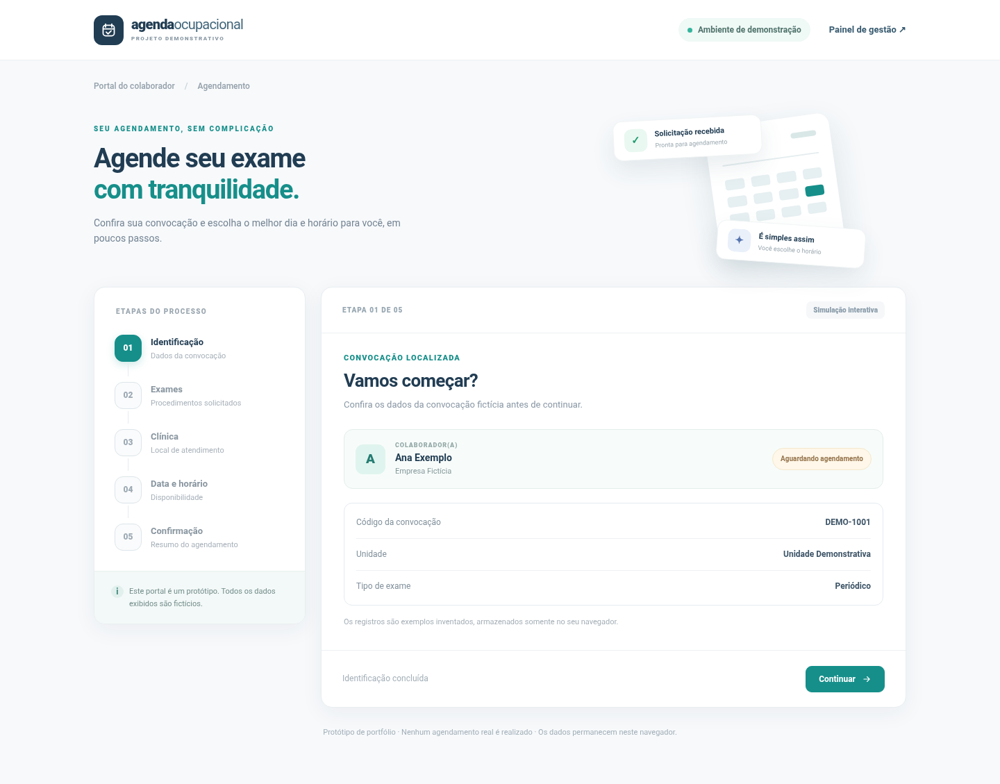
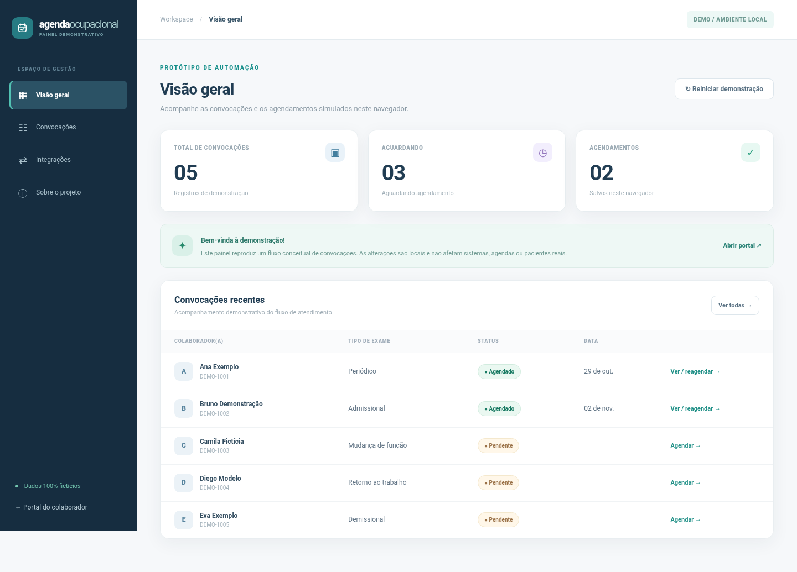

## 🗓️ Occupational Scheduling Automation

**💼 Professional Context | Experimental Prototype**  
**Occupational Health Scheduling & Convocation Automation**  
🔍 Connecting workflows, APIs, and user-centered digital solutions.


---

### 🚀 About the Project

This project originated from a scheduling and convocation challenge encountered in a **professional setting**, rather than from a university assignment. It explores how occupational health exam appointments could be streamlined through **JavaScript, API development, workflow orchestration, and a web-based scheduling experience**.

The original exploration was discontinued after the scheduling platform used at the time introduced an equivalent feature. **This public repository is a separately built demonstration**, based on fictional scenarios; it does not include the original workplace code or represent a deployed company product.

> **Demo only:** All employees, clinics, events, and schedules are fictional. No real appointments are booked, no private systems are accessed, and no sensitive data or credentials are included.

---

### 🔧 Technical Skills


---

### 💻 Programming & Databases


*PostgreSQL/Supabase are represented by an optional SQL schema and isolated adapter example; they are not connected to the live demo interface.*

---

### 🌐 Web Development


*n8n is included as an importable sample workflow, not an active integration.*

---

### 📌 Main Features

- **Employee scheduling portal:** view a fictional convocation, required exams, available clinics, dates, and times.
- **Appointment confirmation & rescheduling:** simulate appointment changes and view a confirmation summary.
- **Management dashboard:** browse fictional convocations, filter by status, search, add sample records, and reset demo data.
- **REST integration example:** validate and normalize JSON, then generate a sample SOAP/XML payload without sending it externally.
- **Signed token example:** issue and verify time-limited HMAC tokens containing opaque demo identifiers, not personal information.
- **Integration references:** sample n8n workflow and optional Supabase schema/adapter for architectural exploration.

The scheduling portal and dashboard share data using browser `localStorage`. This makes the UI easy to explore **without a database or external account**, but does not provide real availability, multiuser synchronization, or production-grade authorization.

---

### 🖥️ Project Preview

| Employee Scheduling Portal | Management Dashboard |
| :---: | :---: |
|  |  |

---

### ⚙️ Getting Started

**Requirements:** Node.js 20 or later. No external packages or accounts required.

From the repository root:

```bash
cd occupational-scheduling-automation
npm start
```

Open the **[Scheduling Portal](http://localhost:3000)** or the **[Management Dashboard](http://localhost:3000/prestador.html)** locally. The portal and dashboard share demo data when opened in the same browser.

To run automated tests:

```bash
npm test
```

#### REST API Example

```bash
curl -X POST http://localhost:3000/api/integration-preview \
  -H "Content-Type: application/json" \
  -d '{"externalId":"DEMO-EVENT-001","examType":"Periódico","unit":"Unidade Demonstrativa","exams":["Avaliação clínica","Audiometria"]}'
```

This endpoint validates a fictional event and returns a normalized JSON response with illustrative SOAP/XML. **It never calls an external SOAP service.** The additional `/api/demo-token` endpoint demonstrates signed tokens; to use it, set a private `DEMO_TOKEN_SECRET` with at least 32 characters. Token issuance is illustrative, **not a complete authentication system**.

---

### 📂 Repository Structure

The public repository currently keeps its source files in a nested project directory:

```text
occupational-scheduling-automation/
├── api/            REST demo endpoints
├── lib/            Validation, integrations, and token examples
├── public/         Scheduling portal and dashboard
├── workflows/      Sample n8n workflow (inactive)
├── supabase/       Optional schema and adapter references
├── samples/        Fictional event payloads
├── tests/          Automated tests
├── docs/           Screenshots and architecture notes
├── server.js       Local Node.js server
└── vercel.json     Serverless route configuration
```

For more details, see [Architecture Notes](occupational-scheduling-automation/docs/ARQUITETURA.md) and [Security Notes](occupational-scheduling-automation/SECURITY.md).

---

### 🚧 Project Status

**Professional context · Original exploration discontinued · Independent portfolio demonstration**

The original exploration was discontinued after equivalent scheduling functionality became available in the software used at the time. The repository documents the technical concepts explored and offers a **safe, fictional implementation** for demonstration.

This is **not** production software: real systems, corporate authentication, live clinic calendars, message delivery, and multiuser persistence are intentionally outside its scope.

---

### 👩‍💻 Developed by

**Isabelle Ramires** · [@Ramirescodes0](https://github.com/Ramirescodes0)

*Independent demonstration of technical concepts explored in a professional context; not an academic assignment or an operational company system.*
